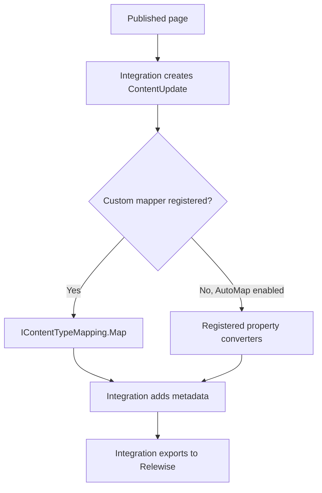

# Custom content mapping

[Documentation home](README.md) · [Block editors](block-editors.md) · [Validation](validation-and-troubleshooting.md)

This guide documents the existing Content mapper/converter API, retained for
compatibility. `IContentTypeMapping`, `IRelewisePropertyValueConverter`, the instance-based
`UseMapper(...)` overload and `AddValueConverter<T>()` are obsolete and produce warnings.
For new code, start with [entity mapping](entity-mapping.md) and
the [demo storefront](../samples/Relewise.DemoStorefront/README.md#mapping-examples).

A content mapper decides which values from one published Umbraco page become Relewise content data. Use it when your export needs editorial rules: extracting text from blocks, combining properties, excluding configuration, or producing a field such as `searchText`.

## Contents

- [Choose an extension point](#choose-an-extension-point)
- [Understand the mapping pipeline](#understand-the-mapping-pipeline)
- [Write a minimal mapper](#write-a-minimal-mapper)
- [Register a mapper](#register-a-mapper)
- [Preserve ordinary property mapping](#preserve-ordinary-property-mapping)
- [Handle cultures](#handle-cultures)
- [When a property converter is appropriate](#when-a-property-converter-is-appropriate)
- [Design the exported data](#design-the-exported-data)

## Choose an extension point

| Requirement | Approach | Scope |
| --- | --- | --- |
| Export supported properties without special rules | `contentType.AutoMap()` | A registered document type |
| Decide what a page contributes, combine fields, or apply site-specific block rules | `contentType.UseMapper(...)` with `IContentTypeMapping` | A registered document type; one mapper can serve several types |
| Teach automatic mapping about a new property editor | `IRelewisePropertyValueConverter` and `services.AddValueConverter<T>()` | Every matching property processed by the converter service |

A **document type alias** selects a page mapping. A **property alias** identifies a
field such as `contentRows`; a **property editor alias** identifies its editor.
Global converters decide whether to handle a field in `CanHandle`, commonly using
the editor alias or property alias. These names have different roles.

The legacy `UseMapper(IContentTypeMapping)` overload takes over property mapping; it does not run after `AutoMap()`. Calling both selects the legacy mapper instead of automatic property conversion. The new `UseMapper<TMapper>()` API is different: it runs after automatic or explicit fields and relationships. Reuse the property converter service inside your mapper if you want ordinary fields converted automatically.

With the legacy `AddContentType(...)` API, registration without `AutoMap()` or a legacy mapper enables tracking without export. In contrast, `MapContent(...)` enables export and tracking by default, even without explicit fields. Set `mapping.Export = false` for a tracking-only mapping in the new API. Register the containing page type for blocks; block element types do not become separate exported pages simply because they occur inside it.

## Understand the mapping pipeline



The integration supplies a `ContentMappingContext` with:

| Member | Purpose |
| --- | --- |
| `PublishedContent` | Published values for the page being exported. Work from these instead of raw editor storage JSON. |
| `ContentUpdate` | The update already initialized with content ID, display name, category paths, and the requested update kind. |
| `CulturesToPublish` | The page's published cultures, or the site's default culture for invariant pages. |
| `GetService(...)` / `GetRequiredService<T>()` | Access to registered services. The context implements `IServiceProvider`. |

**Modify and return `context.ContentUpdate` for the simplest migration path.** The shared indexing pipeline also honors a replacement `ContentUpdate` returned by a legacy mapper, including its update kind and Content ID. Changing that ID inside a mapper does not change the ID resolver used by references and automatic tracking. Move custom identity rules to `IdFromProperty(...)` when migrating to the new API.

The integration owns `UmbracoVersionId`, `contentTypeAlias`, `url`, `createdAt` and
keys beginning with `rwUmbraco`. Source identity, publication and search metadata are
maintained by the shared indexing pipeline. With the default synchronization policy,
`url` and `createdAt` are supplied again after legacy mapping, even if the mapper
replaces the Content or its Data dictionary.

Do not use reserved keys for application fields. Depending on the mapping path, a
collision can fail validation, cause a duplicate-key error or be overwritten by
integration metadata. Use names such as `canonicalUrl` for your own fields.

The mapper does not send a request to Relewise. The export service handles transport and publication lifecycle. Keep extraction independent of HTTP requests, Razor rendering, and the current visitor.

Sources: [shared mapping pipeline](../src/Integrations.Umbraco/Mapping/EntityMapper.cs), [context](../src/Integrations.Umbraco/ContentMappingContext.cs), [configuration](../src/Integrations.Umbraco/RelewiseUmbracoConfiguration.cs).

## Write a minimal mapper

This complete class exports an example invariant text property named `summary`. Replace the alias to match your schema. See [cultures](#handle-cultures) before using this minimal example with translated content.

```csharp
using System.Collections.Generic;
using System.Threading;
using System.Threading.Tasks;
using Relewise.Client.DataTypes;
using Relewise.Integrations.Umbraco;

public sealed class SummaryMapper : IContentTypeMapping
{
    public Task<ContentUpdate> Map(ContentMappingContext context, CancellationToken token)
    {
        token.ThrowIfCancellationRequested();
        var culture = context.CulturesToPublish[0];
        var summary = context.PublishedContent.GetProperty("summary")
            ?.GetValue(culture) as string ?? string.Empty;

        context.ContentUpdate.Content.Data = new Dictionary<string, DataValue?>
        {
            ["summary"] = new DataValue(summary)
        };

        return Task.FromResult(context.ContentUpdate);
    }
}
```

The example supplies only `summary` as application-owned Data. The initialized
DisplayName and category paths remain, and the integration maintains its metadata. Existing fields stored remotely are a separate concern; see [update semantics](validation-and-troubleshooting.md#removed-fields-and-update-semantics).

## Register a mapper

For a stateless mapper with no constructor dependencies, register an instance in your existing Umbraco builder:

```csharp
.AddRelewise(options => options
    .AddContentType("article", type => type.UseMapper(new SummaryMapper()))
    .AddContentType("simplePage", type => type.AutoMap()))
```

Existing instance-based mappers can use the overload that supplies `IServiceProvider` when registered with dependency injection:

```csharp
using Microsoft.Extensions.DependencyInjection;
using Relewise.Integrations.Umbraco;

// Before building the application:
builder.Services.AddSingleton<SummaryMapper>();

// Within your existing builder.CreateUmbracoBuilder() chain:
.AddRelewise((options, services) =>
{
    var mapper = services.GetRequiredService<SummaryMapper>();
    options.AddContentType("article", type => type.UseMapper(mapper));
    options.AddContentType("landingPage", type => type.UseMapper(mapper));
    options.AddContentType("simplePage", type => type.AutoMap());
})
```

The second snippet shows two insertion points, not a standalone `Program.cs`. Keep your existing Relewise client configuration, backoffice, website, and application startup. New implementations can use the scoped `IEntityMapper<Content>` API shown in the [demo's mapping examples](../samples/Relewise.DemoStorefront/README.md#mapping-examples).

Mapper instances are retained by the integration configuration. Treat them as shared services: keep per-page state in local variables, avoid capturing scoped services, and make dependencies safe to share. Do not store the current page or culture in an instance field. If extraction requires I/O, make it asynchronous and pass the cancellation token through.

## Preserve ordinary property mapping

Resolve `IRelewisePropertyConverter` from the mapping context and give it the properties you want to preserve:

```csharp
// Inside an async Task<ContentUpdate> Map method; add Microsoft.Extensions.DependencyInjection,
// Relewise.Integrations.Umbraco.Services, and System.Linq imports.
var converter = context.GetRequiredService<IRelewisePropertyConverter>();
var ordinaryProperties = context.PublishedContent.Properties
    .Where(property => property.Alias is "title" or "summary" or "tags");
var data = (await converter.ConvertAsync(ordinaryProperties, context.CulturesToPublish.ToArray(), token))
    .ToDictionary(pair => pair.Key, pair => pair.Value);

// Add your derived fields here, then assign data to context.ContentUpdate.Content.Data.
```

This property-only overload preserves the selected fields but has no owning-page or
source-element context. Converters that need that context should use the contextual
`ConvertAsync(publishedContent, sourceElement, cultures, services, cancellationToken)`
overload, which converts all properties of the supplied source element, or the new
explicit field mappings.

An explicit list is usually easiest to reason about: adding an editor-only field to Umbraco will not silently make it part of the exported data. To preserve a broader existing export, filter out the properties your mapper owns and reserved keys, then convert the rest. Conversion preserves the behavior of **registered converters**, not all possible editor types. An unsupported property can be omitted without an error.

Exclude custom-handled Block Lists before conversion if you want to avoid running the default Block List converter unnecessarily. Keep field ownership clear so two parts of your mapper cannot accidentally produce the same key.

## Handle cultures

Pass a culture explicitly when reading a property: `property.GetValue(culture)`. Do not use the current HTTP request language to drive exports; exports can run outside a visitor request.

For a single language, a `DataValue` containing a string is sufficient. To carry several language versions in one field, use a `Multilingual` value:

```csharp
// textForCulture represents your own extraction function.
var values = context.CulturesToPublish
    .Select(culture => new Multilingual.Value(culture, textForCulture(culture)))
    .ToArray();
data["searchText"] = new DataValue(new Multilingual(values));
```

The ordinary converter service applies its own rules: invariant properties use the first culture; variant strings with several values become `Multilingual`; string lists become `MultilingualCollection`; other variant types can get culture-suffixed keys. See [the implementation](../src/Integrations.Umbraco/Services/RelewisePropertyConverter.cs).

For derived block text, consider the whole composition. An invariant container can contain culture-dependent values or references. The demo's final entity mapper extracts invariant outer blocks separately for each published page culture. Decide your fallback rules explicitly, and test a missing translation. It reads published property values directly and does not add a custom fallback policy.

## When a property converter is appropriate

A converter is useful when one editor has the same meaning everywhere it is used. This example supports an illustrative custom editor alias, `Acme.PlainText`; it assumes that editor returns a string:

```csharp
using Relewise.Client.DataTypes;
using Relewise.Integrations.Umbraco;

public sealed class PlainTextPropertyConverter : IRelewisePropertyValueConverter
{
    public bool CanHandle(RelewisePropertyConverterContext context) =>
        context.Property.PropertyType.EditorAlias == "Acme.PlainText";

    public void Convert(RelewisePropertyConverterContext context)
    {
        var text = context.Property.GetValue(context.Culture) as string ?? string.Empty;
        context.Add(context.Property.Alias, new DataValue(text));
    }
}
```

Register it before the service provider is built:

```csharp
builder.Services.AddValueConverter<PlainTextPropertyConverter>();
```

This makes it available to automatic mapping and to custom mappers that call `IRelewisePropertyConverter`.

**All matching legacy synchronous converters still run.** Their registration order
does not provide a safe override: `context.Add` throws if two converters write the
same key. New asynchronous global converters follow a different rule: the last
matching custom registration takes precedence over built-in defaults. It does not
suppress separately registered legacy custom converters. See
[converter selection](entity-mapping.md#conversion-and-custom-mapping). Prefer a
field-specific converter or entity mapper for page-specific Block List behavior.
Do not remove internal converter classes by their type-name strings.

If a legacy synchronous converter needs the aggregate `IRelewisePropertyConverter`, constructor-injecting it creates a dependency cycle: the aggregate is constructed from the registered legacy converters. The built-in nested converters resolve it during conversion through a service provider instead. For page-specific composition, a mapper avoids that converter-level cycle altogether.

## Design the exported data

Choose a stable, intentional schema before writing a recursive walker:

| Example field | Contents | Why |
| --- | --- | --- |
| `title` | Page title | Display and search relevance |
| `summary` | Editorial introduction | Search result excerpt |
| `searchText` | Selected visible text from blocks | Searchable page body |
| `tags` | Editorial tags | Filtering or matching |
| `heroImageUrl` | Resolved media URL | Display; keep separate from prose |

A mapper does not configure search weights, filters, or which fields your search setup searches. Verify those separately in your Relewise setup. Exporting a field and making it influence search are separate steps.

Next: [map Block List and Block Grid](block-editors.md), or open the [demo's mapping examples](../samples/Relewise.DemoStorefront/README.md#mapping-examples).
